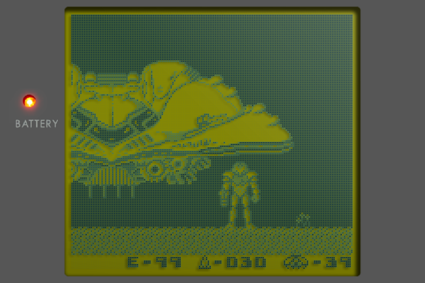
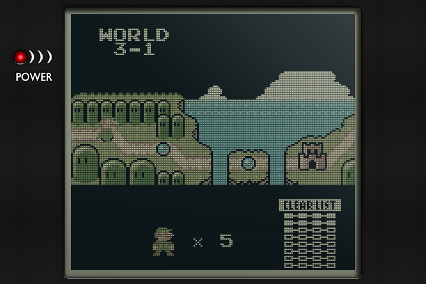
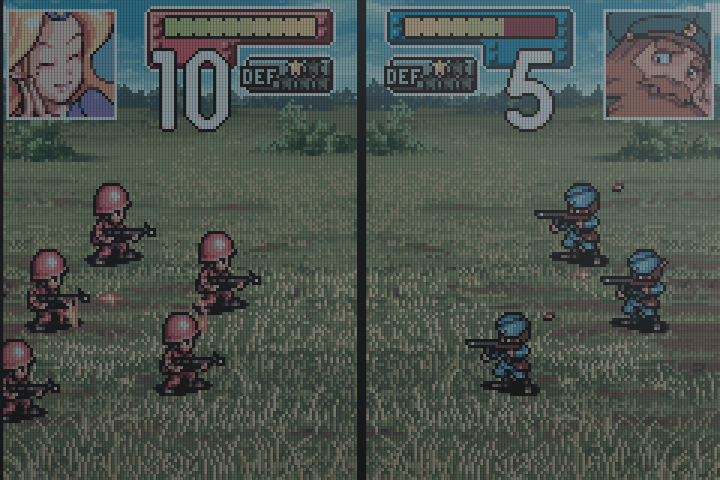

---

# What is slot?

A fork of [slot](https://github.com/BrandonKowalski/slot) by Brandon Kowalski. slot is a
bespoke, Game Boy-centric frontend for the Anbernic RG SP. Brandon wrote slot and its guide.
This fork follows upstream and adds the features listed below.

Has support for GBA, GBC, and GB titles only.

> [!IMPORTANT]
> ROMs must be unzipped. slot does not read `.zip` or `.7z` files.

The user guide is upstream's, at [slot-cfw.fyi](https://slot-cfw.fyi). Upstream's release
notes are in the [changelog](CHANGELOG.md).

## What this fork adds

- **Lower input lag with automatic 120 Hz** on supported RG SP, RG34XX SP, and RG34XX
  panels. Other panel revisions keep their existing refresh rate.
- **Automatic CPU scaling** with `schedutil` for GB, GBC, gpSP, and paused play.
  Running GBA games on mGBA use `performance` to keep frames on time.
- **Authentic LCD shaders** recreate the reflective screens' colours, pixel grid, ghosting,
  and glass, with shadows from the dots and bezel. Game Boy offers Game Boy, Pocket, and
  Light models. The default bezel is cut from Harlequin's dmg-3x art, with its glass and
  power light. Pick **Authentic** under **Settings > Screen > your system > Shader**.
  The shaders are also [available for NextUI](https://github.com/pvaibhav/authentic-shaders).
- ~~**LCD ghosting / interframe blending.**~~ Included upstream since **v1.10.0**
  as **Frame Blending** under Settings > Screen.
- **Colour calibration** for the RG SP and RG34XXSP panels, based on an accurate 3x1D LUT
  measured by me. Both white point and gamma curve are corrected. Currently no other firmware
  has this!
- ~~Holding POWER **shuts down** directly, without showing a menu.~~
  Included upstream since **v1.8.0**. Restart is available from Settings > About with X.
- ~~**Home Wi-Fi.**~~ Included upstream since **v1.13.0** as the **Network** menu. Join your
  network there. slot deletes the old `Config/wifi.toml` on first start.
- **Wi-Fi stays connected while you play.** If Wi-Fi is connected when you put a cart in, it
  stays connected, so RetroAchievements stay online. slot never starts a connection during a
  game, because a scan can stall frames.
- ~~**Online cart label scraping.**~~ Included upstream since **v1.13.0** as **Fetch Missing
  Art** under Network. No Wi-Fi? Put `Artwork.pack` from the release page in your card's
  `Labels` folder and slot labels your carts from that instead.
- **RetroAchievements.** You can earn softcore GB, GBC, and GBA achievements, online or offline.
  Put your account in `Config/retroachievements.toml` for this to work. slot caches all your
  games' achievements while Wi-Fi is connected. Once that sync is done, you can play away from
  Wi-Fi and keep what you earn. It syncs when Wi-Fi connects again. When you play
  with Wi-Fi connected, your achievements sync in real time with rich presence.
  A holographic trophy seal on a cart's label shows it's ready to earn achievements offline.
- ~~**Linking over home Wi-Fi.**~~ Removed. Links use upstream's direct link, which needs no
  network. Wi-Fi is off during a link, and achievements you earn then sync after it ends.
- **Cheats.** Put `Cheats.pack` from the release page in `Cheats/`, and a game's cheats from the
  libretro database appear under **Cheats** in its in-game menu, each with an On/Off switch.
  slot remembers which are on for each game. To use your own, add a RetroArch `.cht` file named
  after the ROM to `Cheats/GBA`, `Cheats/GB` or `Cheats/GBC`. Cheats need the mGBA core.
  Gambatte, the default Game Boy core on new cards since v1.14.0, has no cheats yet.
- **Network time from BaseOS.** **Set Automatically** in Date & Time turns BaseOS's `ntpd` on
  or off. slot no longer asks a time server itself.
- **`slot.local` beside the device's own name.** Gamebit answers at `slot.local`, and BaseOS
  still answers at `<hostname>.local`. If another device already has `slot.local`, slot takes
  `slot-2.local`. `mdns=false` in BaseOS's settings turns both off.
- **Updates from this fork.** Network > Check for Updates installs this fork's releases, never
  upstream's.

Your Frame Blending choice carries over when you update.

With Authentic, GB and GBC games run smoothly at a lower CPU speed, which saves battery.
GBA games on mGBA run at full speed so they stay smooth.

## How to configure

Join your Wi-Fi network from **Network** in the shelf menu. For RetroAchievements, the release
includes `Config/retroachievements.toml.example`. Remove `.example` from the name, and fill in
your account. Everything else is automatic.

## Versions

A release of this fork uses upstream's version with a suffix. `v1.4.0-pvaibhav.1` is the
first release built on upstream 1.4.0, and `v1.4.0-pvaibhav.2` would be the second.

The current release is [v1.14.0-pvaibhav.1](https://github.com/pvaibhav/slot/releases/tag/v1.14.0-pvaibhav.1).
Its [release notes](RELEASE_NOTES.md) describe the changes since the previous fork release.

## Release cadence

This fork is synced to upstream slot releases every day at **07:30 CET Berlin time /
01:30 EST New York time**. If a new version of slot
is available, it is merged into this fork and released automatically.

I release new features as I build and test them. They are carried forward in every new release.

---

# What does it look like?

Authentic on Game Boy, Game Boy Color and Game Boy Advance, rendered from captured game
frames at 720×480 with this release's shaders and bezels.

Game Boy · Game Boy Color · Game Boy Advance

---

# Supported Devices

| Device             | Supported                                    | Since Version |
|--------------------|----------------------------------------------|---------------|
| Anbernic RG SP     | Yes                                          | Always        |
| Anbernic RG34XX    | Yes                                          | 1.4.0         |
| Anbernic RG34XXSP  | Yes                                          | 1.4.0         |
| Anbernic RG35XXSP  | Yes                                          | 1.5.0         |
| Anbernic 35XX Plus | Yes                                          | 1.5.0         |
| Anbernic RG28XX    | Yes                                          | 1.6.0         |
| Anbernic RG35XX-H  | Yes                                          | 1.7.0         |

If you have one of the untested devices, or have tried slot on a device not listed,
please [open an issue on GitHub](https://github.com/BrandonKowalski/slot/issues) and let me know how it went.

---

# Discord Community

slot has a [Discord server](https://discord.gg/NYRWsSuPUu) for questions, sharing setups, and talking about the project.

It is open to everyone in the slot universe. That includes folks running or building forks of slot.

There is no reason for this community to be fragmented so long as we are having fun!

---

# AI Disclosure

From upstream:

The Rust frontend, and the SVGs on [slot-cfw.fyi](https://slot-cfw.fyi), were put together by Claude.
I reviewed everything that was produced. All documentation is 100% free-range, meatbag prose.

My goal with this project was to recreate the feeling of playing my GBA SP in the back seat as a kid,
but with a few modern creature comforts.

Nothing about this project is exciting or groundbreaking from a technological perspective, and as a
result, I delegated the glue code. mGBA and gpSP have been around forever and are the true stars of
this show. The incredible skeuomorphic art is the work of [Markus](https://github.com/MarkusMaribu), an
artist who saw the bare-bones version and offered to dress it up.

I understand if my use of AI is a dealbreaker for you. Just know it's the least interesting part of
what's here.

This fork's additions were written with AI assistance too.

Figured I should share the end result of all the wasted water. ✌🏻

---

# Spread Joy!

I've spent a lot of time building slot.

If you enjoy using it and feel inclined to pay it forward, go do something nice for someone! ❤️
