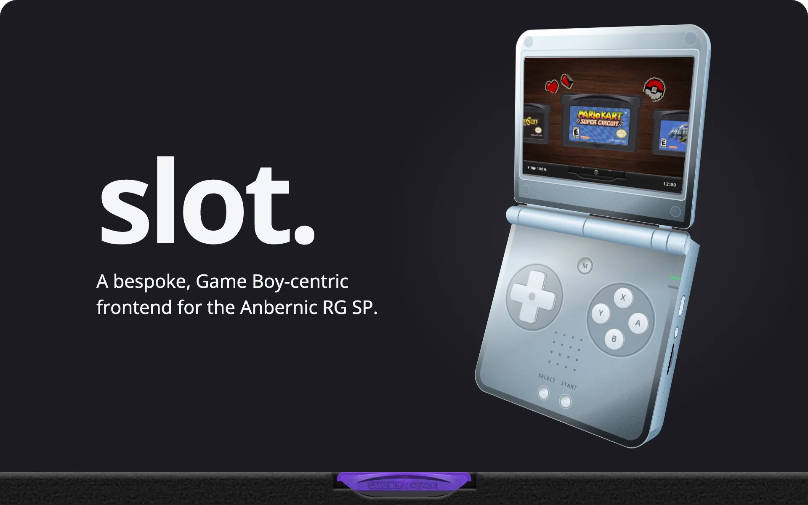
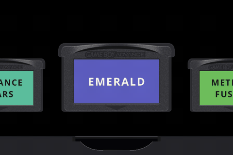

 

---

# What is slot?

A bespoke, Game Boy-centric frontend for the Anbernic RG SP.

Has support for GBA, GBC, and GB titles only.

---

# What does it look like?

---

# Supported Devices

| Device                | Since Version |
|-----------------------|---------------|
| Anbernic RG SP        | Always        |
| Anbernic RG 34XX      | 1.4.0         |
| Anbernic RG 34XXSP    | 1.4.0         |

## Devices I never wanted to support that slot works on

| Device                | Since Version |
|-----------------------|---------------|
| Anbernic RG 35XXSP    | 1.5.0         |
| Anbernic RG 35XX Plus | 1.5.0         |
| Anbernic RG 35XX-H    | 1.7.0         |
| Anbernic RG 35XX Pro  | 1.15.0        |
| Anbernic RG 28XX      | 1.6.0         |

---

# AI Disclosure

The Rust frontend, and the SVGs on [slot-cfw.fyi](https://slot-cfw.fyi), were put together by Claude.
I reviewed everything that was produced. All documentation is 100% free-range, meatbag prose.

My goal with this project was to recreate the feeling of playing my GBA SP in the back seat as a kid,
but with a few modern creature comforts.

Nothing about this project is exciting or groundbreaking from a technological perspective, and as a
result, I delegated the glue code. mGBA, gpSP and Gambatte have been around forever and are the true stars of
this show. The incredible skeuomorphic art is the work of [Markus](https://github.com/MarkusMaribu), an
artist who saw the bare-bones version and offered to dress it up.

I understand if my use of AI is a dealbreaker for you. Just know it's the least interesting part of
what's here.

Figured I should share the end result of all the wasted water. ✌🏻

---

# Spread Joy!

I've spent a lot of time building slot.

If you enjoy using it and feel inclined to pay it forward, go do something nice for someone! ❤️
