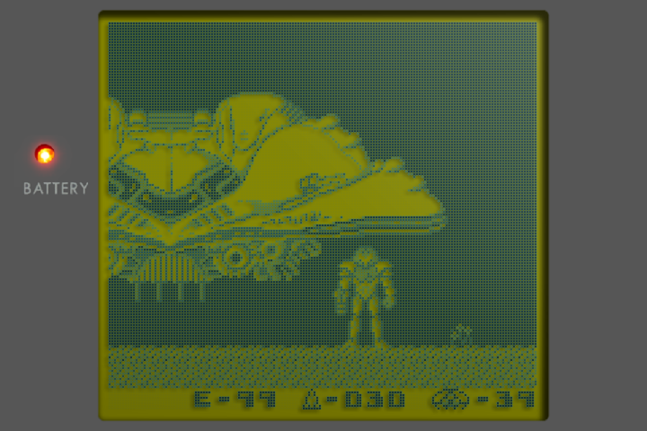
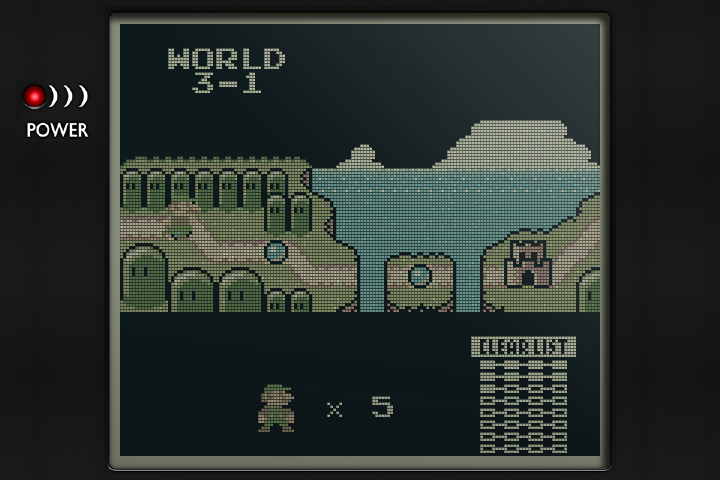
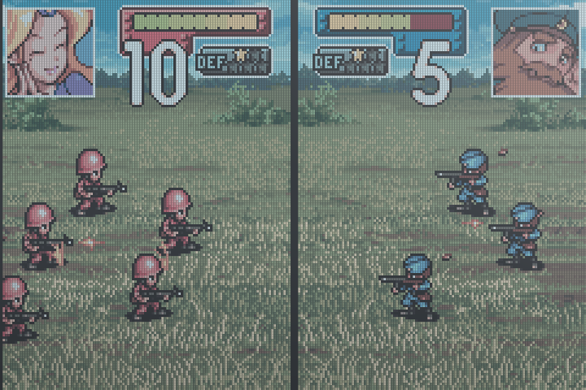
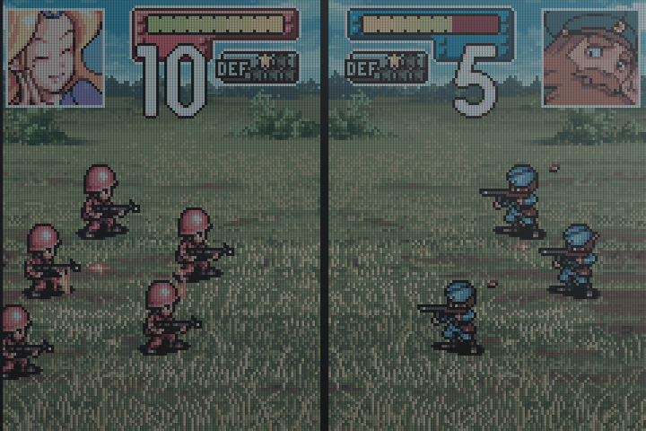

# v1.12.0-pvaibhav.3

- **New Authentic bezels**, cut from Harlequin's dmg-3x and gb-pocket-3x border art: the lens, the window's glass and shadow, and the power light. Game Boy uses the grey lens; Pocket, Light and GBC use the black one. They appear with the default bezel at whole-number scale.
- **Truer GBA colours.** The GBA keeps its measured colours and cool panel tint, now at the GBC's brightness with deeper blacks, so games no longer look foggy.
- **Deeper dot shadows** on the Game Boy screens: a game pixel down and to the left.
- Ghosting stays on the GPU for every Authentic screen.

The same shaders are also available for NextUI at [authentic-shaders](https://github.com/pvaibhav/authentic-shaders).

## Before and after

Rendered from captured game frames at 720×480. Left: v1.12.0-pvaibhav.2. Right: this release.

## Install or update

Unzip `slot-v1.12.0-pvaibhav.3-h700.zip`, then copy the contents of `slot-v1.12.0-pvaibhav.3/` onto SD2. Your games, saves, settings, and credentials are preserved.

`Cheats.pack` and `Artwork.pack` are unchanged. Keep your existing copies, or put them in `Cheats/` and `Labels/` respectively.

Cheats are from the [libretro database](https://github.com/libretro/libretro-database) and its contributors, under [CC BY-SA 4.0](https://creativecommons.org/licenses/by-sa/4.0/). Cart artwork is from the [LaunchBox Games Database](https://gamesdb.launchbox-app.com) and belongs to the respective publishers; the artwork pack is for personal use.

Emulation by mGBA (MPL-2.0) and gpSP (GPL-2.0). Licences, patches, and gpSP source are in `System/licenses/`.
